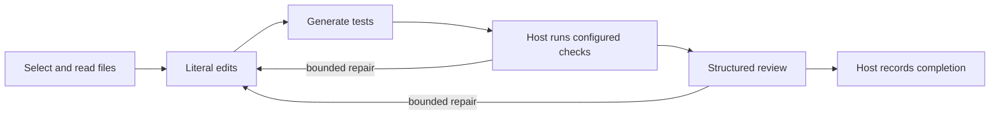

# Controlled workflow

CorePilot offers an opt-in host-controlled workflow for small local models. The host selects and reads real files, limits literal patches to a validated plan, creates tests at fixed paths, runs operator-configured checks, and requests a short review. After fresh checks and approval, the host produces the final report without another model turn. Existing free-form and specialist workflows remain available.

Selection includes a lightweight project navigator. It ranks current file paths and observed Python definitions/imports against the request, with line numbers and source hashes. The map is rebuilt from the isolated checkout, bounded in files, bytes and output size, and marked incomplete when necessary. It uses the CPU and makes no model call. Other languages currently receive filename hints rather than parsed symbols. The map is untrusted location guidance: it does not satisfy required file reads, infer a complete call graph, choose check commands or approve changes.



A coding agent can configure the workflow after registering a repository and checking its conventions:

```sh
corepilot workflow configure --project demo \
  --check-json '["python", "-m", "unittest", "discover", "-s", "tests", "-v"]'
corepilot workflow show
corepilot serve
```

The command enables the controlled workflow and resource guard, and disables specialist orchestration as the default. `--check-json` can be repeated for up to five exact argv arrays. Choose the repository's actual checks; the model cannot supply replacement commands. Optional `--edit-path`, `--read-path`, and `--test-root` constrain the project profile. Inspect the files and dependency declarations before configuring commands. Restart a running interface to load updated configuration.

An editing task requires configured checks. Existing tests are protected; only selected new test files, or unchanged files previously authored by that task, can be written. Literal patches must match actual read source exactly once; Python edits must parse and preserve existing top-level public definitions. An explicit “Change only …” clause restricts every writable path, including new tests. Oversized context, unsupported edits, missing dependencies, invalid structured responses and exhausted repair budgets leave an interrupted checkpoint. These constraints currently suit focused Python edits and source inspection; broad rewrites need a different workflow.

The controller accepts one complete JSON fence and supplies neutral host metadata when an otherwise valid edit/test object omits only its `summary`. It records these normalizations while preserving the raw response. Paths, source text, test content, review approval and requested answer format still require their existing validation; incomplete JSON is never repaired.

Neural stages receive actual host read receipts as untrusted context data, without native assistant/tool dialogue or instructions to execute tools. The original host calls and replies remain paired in the checkpoint. Each stage returns its own schema; the host performs the validated operations. This avoids presenting unavailable tools as an example for the model to imitate.

With `controlled.artifact_protocol: "stage"` and native inference, each stage exposes exactly one data-only function: `submit_select`, `submit_edit`, `submit_tests`, `submit_inspect` or `submit_review`. Its schema describes that stage's paths, literal patches, test content, answer/references or review decision. These functions cannot read or write files or run commands. The client preserves the exact argument string, and the controller pairs the submission with an acceptance or rejection receipt before any validated host operation. Wrong function names, multiple calls, prose mixed with a call, truncated output, malformed JSON and invalid scope remain rejected. Existing semantic, source-freshness, test and check gates still apply; optional edit/test summary metadata is handled by the same neutral host default described above.

The native request includes `tools` and a named `tool_choice`, but this is a protocol request, not grammar-constrained decoding. A server may ignore it, as MLX serving currently does; strict host validation remains necessary. Explicit JSON mode retains the text adapter, with the serialized stage object inside its `final` string. The existing `auto` adapter can switch to JSON when a server rejects the native request. Scripted clients without `complete_stage` retain the prior text contract. Neither a typed schema nor a successful submission establishes autonomous coding quality.

Rejected submissions now receive bounded repair feedback. Python syntax rejection preserves actual diagnostic fields, including at most 250 characters of the offending line, in the rejection receipt and verification event. The next attempt receives up to 4000 characters of the original rejected draft as untrusted context, with explicit clipping metadata; the full original remains in the checkpoint. Generic guidance permits `patches: []` when no further edit is needed and asks for compact, valid tests. The initial-change requirement, strict schema/scope checks, two-attempt submission limit and global call/context budgets still apply. These diagnostics provide a correction opportunity; they do not repair source automatically or demonstrate a quality improvement.

Failed-check feedback is also bounded for model context. The latest two feedback entries retain check argv, exit code, timeout status, tool-operation number and source fingerprint. Only the most recent failed check in those entries includes output: up to 1400 original characters; longer output uses the first 400 and last 1000 characters plus an explicit clipping marker and original length. The original bounded tool output and check receipts remain in the checkpoint. Current-check context carries the same metadata without duplicating output, and authored tests are identified by their hashes and whether their contents are present in actual reads. These smaller views do not replace source observations, alter recorded outcomes or permit approval after files change.

An opt-in alternative sets `controlled.artifact_protocol` to `"documents"` in the existing configuration; the default is `"stage"`. Only edit/test stages change: each request returns the complete text of one fixed, host-selected file, without a model-supplied path or old-text block. Native selection, inspection and review retain their typed submissions. A single whole-answer fence with the matching source language, or no language label, is accepted. The JSON adapter still requires an exact complete `{"final": "file text"}` envelope; malformed JSON is not scanned or repaired. The host derives the path and exact old text from validated selection and actual reads, then applies the existing syntax, public-definition, scope, authored-test and freshness checks. An unchanged document cannot satisfy the initial source-change requirement. Each document has at most two attempts, charged against the same global call/context limits; selecting multiple files requires additional requests. This option reduces serialization work while leaving task completion dependent on actual checks and review.

Python file documents receive conservative cosmetic normalization before their existing validation. The helper removes safe trailing spaces/tabs, normalizes safe line endings to LF and adds a final newline only when the complete parsed AST, including type comments, remains unchanged. Physical lines touched by multiline string, f-string or template literals retain their exact text; protected trailing whitespace can still fail a repository style rule. Indentation, imports, quote choices and blank-line counts are not rewritten. Invalid, oversized or AST-changing candidates retain their original text for the usual validation. A verification receipt records raw/normalized hashes and change counts, while the original model response remains intact. This is not a general formatter or a substitute for behavior, scope or compatibility checks.

For explicit benchmark configuration, use `--mode controlled --controlled-artifact-protocol documents` with `--protocol native` or `--protocol json`; omit the artifact option or select `stage` for the original contract. `--controlled-max-repairs` accepts **0, 1 or 2** and defaults to **1**; it explicitly sets `controlled.max_repairs` for the benchmark and is recorded alongside the artifact option in settings and controlled records. A repair round follows failed configured checks or review; it is distinct from the two-attempt limit for each submission/document. Choosing two repairs does not add model calls or extend the task's global call, context, time or resource budgets. See [benchmark methodology](benchmarks.md). These capabilities are not an established quality improvement; new configurations need separately recorded evaluation.

Checks run in the existing macOS command sandbox with implementation and tests read-only, temporary artifacts writable, network denied, and credential/Git metadata reads denied. Successful commands and model approval remain fallible evidence: they do not establish complete behavior coverage or autonomous task quality. Independent held-out evaluation is still required.

Controlled tasks always use the resource guard. Legacy tasks opt in through `resource_guard.enabled`. Defaults block memory warning, less than 2 GiB estimated available memory, over 512 MiB session swap growth, observed thermal/performance warnings, or a 180-second task limit. The swap baseline spans successful tasks. Missing thermal readings remain unknown; the guard does not measure case temperature or guarantee hardware health.

A resource stop persists a local hold and preserves the task. Cancelling an HTTP request does not prove the external model stopped generating. Stop the model server, confirm it is idle, then use the interface's model-status panel to check resources and clear the hold. This explicit action does not restart models or tasks. CorePilot never kills unrelated applications or automatically restarts computation.

The implementation is tested with scripted responses and actual sandbox checks. Initial 1.5B controlled-mode development comparisons failed to complete tasks; consult the [benchmark ledger](benchmarks.md) for separate frozen reports, diagnostic follow-ups and limitations. A controller passing scripted tests does not establish local-model coding quality.

A separate [native saved-checkpoint continuation](../benchmarks/results/2026-10-11-controlled-4b-native-checkpoint-continuation.json) reused an exposed development task with a pre-existing partial patch and explicit operator steering. It interrupted after 53.453 seconds and four new calls: one selection submission was accepted, but both edit submissions omitted their patch path and proposed identical old/new text. It reached no test, command-check or review stage and changed no additional source. The surviving patch still passed 12 external unittest executions, while the missing requested test file kept the full oracle and usable result false. This failed continuation is retained; it is not a fresh initial-task benchmark, training improvement, navigator evaluation, model ranking or comparative speed result.

The separately [declared initial-task development run](../benchmarks/results/synthetic-v3-controlled-4b-native-initial-development-plan.json) started from the original clean synthetic repository, without a pre-existing patch and with the unchanged case request. Its [exact report](../benchmarks/results/2026-10-11-controlled-4b-native-initial-development.json) records **0/1 usable and oracle passes**, interrupted after **87.862 seconds / four calls** (selection one, edit one, tests two). The allowed implementation passed 12 external unittest executions with zero behavior failures and zero integrity/style errors, but the requested test file remained missing. Both native test submissions contained complete typed JSON; their Python bodies failed syntax validation, so the host accepted no test file and ran no command check or review. All four HTTP requests returned usage, with no length-limited response, timeout or resource abort. The pinned source, plan and full suite hashes matched, and the baseline matched the original repository. This repeated, exposed development case is not fresh held-out evidence; its failed full cycle is retained separately from the checkpoint continuation and earlier configurations.

The separately [declared feedback follow-up](../benchmarks/results/synthetic-v3-controlled-4b-native-feedback-development-plan.json), on the same clean baseline and unchanged request, also [failed the full cycle](../benchmarks/results/2026-10-11-controlled-4b-native-feedback-development.json): **0/1 usable and oracle passes**, **131.773 seconds / six calls** (selection one, edit three, tests two). The host accepted three typed submissions, including a new test file, but its command check exited 1 with an uncaught `TypeError` from that authored test; subsequent edit submissions lacked required patch fields, and no review decision occurred. The external oracle ran **22 unittest executions with zero failures and one authored-test error**, with zero integrity/style errors. All six HTTP attempts returned usage, with no output truncation, timeout or resource abort. Source, plan and suite hashes matched. This partial progress does not establish a completed task or causal quality gain; it remains separate adaptive development evidence.

The separately [declared documents-mode run](../benchmarks/results/synthetic-v3-controlled-4b-native-documents-development-plan.json) completed the same known development task from its clean original baseline and unchanged request. Its [exact report](../benchmarks/results/2026-10-11-controlled-4b-native-documents-development.json) records **one completed usable/oracle pass**, **71.642 seconds / four calls**, one each for selection, edit, tests and review. The host created the allowed source change and one test file, executed one current command check with exit 0 and recorded one approved review; the independent oracle ran **28 unittest executions with zero failure, error, integrity, style or required-read errors**. All four actual HTTP requests returned usage, with no truncation, timeout or resource stop. The workspace was unapplied, check/source fingerprints and authored-test hashes remained current, and the pinned source and full suite were unchanged. This stock 4B native run used `documents`, no adapter or memory, and the declared eight-call / 2048-token / 22,000-character / 180-second limits. It is the first observed full cycle on this repeatedly exposed case, **not a fresh held-out score, general success rate, training or navigator gain, model ranking or speed comparison**; all prior failed configurations remain separate.
