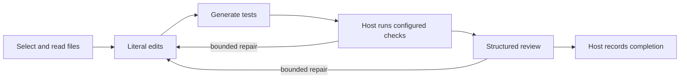

# Controlled workflow

CorePilot offers an opt-in host-controlled workflow for small local models. The host selects and reads real files, limits literal patches to a validated plan, creates tests at fixed paths, runs operator-configured checks, and requests a short review. After fresh checks and approval, the host produces the final report without another model turn. Existing free-form and specialist workflows remain available.

Selection includes a lightweight project navigator. It ranks current file paths and observed Python definitions/imports against the request, with line numbers and source hashes. The map is rebuilt from the isolated checkout, bounded in files, bytes and output size, and marked incomplete when necessary. It uses the CPU and makes no model call. Other languages currently receive filename hints rather than parsed symbols. The map is untrusted location guidance: it does not satisfy required file reads, infer a complete call graph, choose check commands or approve changes.



A coding agent can configure the workflow after registering a repository and checking its conventions:

```sh
corepilot workflow configure --project demo \
  --check-json '["python", "-m", "unittest", "discover", "-s", "tests", "-v"]'
corepilot workflow show
corepilot serve
```

The command enables the controlled workflow and resource guard, and disables specialist orchestration as the default. `--check-json` can be repeated for up to five exact argv arrays. Choose the repository's actual checks; the model cannot supply replacement commands. Optional `--edit-path`, `--read-path`, and `--test-root` constrain the project profile. Inspect the files and dependency declarations before configuring commands. Restart a running interface to load updated configuration.

An editing task requires configured checks. Existing tests are protected; only selected new test files, or unchanged files previously authored by that task, can be written. Literal patches must match actual read source exactly once; Python edits must parse and preserve existing top-level public definitions. An explicit “Change only …” clause restricts every writable path, including new tests. Oversized context, unsupported edits, missing dependencies, invalid structured responses and exhausted repair budgets leave an interrupted checkpoint. These constraints currently suit focused Python edits and source inspection; broad rewrites need a different workflow.

The controller accepts one complete JSON fence and supplies neutral host metadata when an otherwise valid edit/test object omits only its `summary`. It records these normalizations while preserving the raw response. Paths, source text, test content, review approval and requested answer format still require their existing validation; incomplete JSON is never repaired.

Neural stages receive actual host read receipts as untrusted context data, without native assistant/tool dialogue or instructions to execute tools. The original host calls and replies remain paired in the checkpoint. Each stage returns its own schema; the host performs the validated operations. This avoids presenting unavailable tools as an example for the model to imitate.

Checks run in the existing macOS command sandbox with implementation and tests read-only, temporary artifacts writable, network denied, and credential/Git metadata reads denied. Successful commands and model approval remain fallible evidence: they do not establish complete behavior coverage or autonomous task quality. Independent held-out evaluation is still required.

Controlled tasks always use the resource guard. Legacy tasks opt in through `resource_guard.enabled`. Defaults block memory warning, less than 2 GiB estimated available memory, over 512 MiB session swap growth, observed thermal/performance warnings, or a 180-second task limit. The swap baseline spans successful tasks. Missing thermal readings remain unknown; the guard does not measure case temperature or guarantee hardware health.

A resource stop persists a local hold and preserves the task. Cancelling an HTTP request does not prove the external model stopped generating. Stop the model server, confirm it is idle, then use the interface's model-status panel to check resources and clear the hold. This explicit action does not restart models or tasks. CorePilot never kills unrelated applications or automatically restarts computation.

The implementation is tested with scripted responses and actual sandbox checks. Initial 1.5B controlled-mode development comparisons failed to complete tasks; consult the [benchmark ledger](benchmarks.md) for separate frozen reports, diagnostic follow-ups and limitations. A controller passing scripted tests does not establish local-model coding quality.
