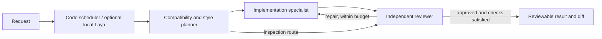

# Lightweight specialist orchestration

CorePilot uses a small code scheduler with a checkpointed plan/execute/review workflow. It does not call a large language model to schedule work. An optional local typed decision model can select an inspection route. Each specialist has an explicitly configured model and endpoint; missing roles or failed requests never trigger the single-model fallback.



This combines the established [orchestrator-workers and evaluator-optimizer patterns](https://www.anthropic.com/engineering/building-effective-agents). The workflow is fixed and bounded; model-generated plans do not create arbitrary agents or change tool permissions.

## Responsibilities

| Role | Work | Available tools |
|---|---|---|
| Planner | Read repository instructions, current architecture, nearby code and tests; produce compatibility and style constraints | List, search, read, `submit_plan` control tool |
| Coder | Implement the request according to the contract; validate actual changes | List, search, read, edit, sandboxed commands |
| Reviewer | Read current changed files and diff; check compatibility, style and observed validation; produce a structured decision | List, search, read, sandboxed commands; source writes interrupt the task |

The planner must read existing root `AGENTS.md` and `CLAUDE.md` plus source evidence. The reviewer must read existing changed files. A prose claim does not count as a read or a passing check. Failed or stale required validation prevents completion, even if the reviewer approves. The reviewer returns `{"approved": true, "summary": "Observed result", "issues": []}`; invalid decisions receive bounded correction attempts and then interrupt the task. Rejections return to the coder only within the configured budget.

The planner can explicitly hand off with `submit_plan` using exactly `{"contract": "Observed interfaces, constraints, changes and validation approach"}`. The contract must be a nonempty string of at most 6,000 characters, with no extra fields. This is a planner-only control tool, not a file edit or task approval. It must be the only call in its assistant batch, and the response must not report `finish_reason: "length"`. Before acceptance, the engine requires successful current-phase reads of each existing root `AGENTS.md`/`CLAUDE.md` file and at least one non-guidance project file, plus unchanged phase source. Automatically supplied guidance excerpts do not count as reads. Plain-text planning handoffs remain supported under the same evidence gates.

An accepted call receives the paired result `{"accepted": true, "transition": "pending paired handoff", "completes_task": false}`. A persisted pending-plan intent is consumed once, after tool replies are drained, to enter coding or the inspection reviewer. Cancellation before acceptance records an interrupted tool result; cancellation after pairing preserves the intent for explicit resume, which rechecks the gates before transitioning. User steering clears that intent and starts planning again. Unpaired or corrupt intent interrupts the task and cannot advance it. Acceptance permits a phase handoff, not task completion or a judgment that the contract is correct. Budget pressure never forces a transition; source-integrity, validation and reviewer requirements remain active. Its protocol support does not demonstrate a model-quality gain; that requires a separate [evaluation](benchmarks.md).

Checks are bound to the observed source fingerprint before execution. A subsequent source change, including a writing command, requires fresh validation. Older checkpoints without this fingerprint can be resumed but must rerun required checks.

Each phase receives the original request, corrections, selected project context and a bounded handoff. Roles share one isolated workspace per task, with one writer. Current phase messages, pending calls, contracts and decisions survive cancellation/restart. Resuming unchanged work retains its phase; a steering message starts planning again. Applying the resulting diff remains a separate user action.

## Configure specialists

Start compatible local model servers, or ask a terminal-capable coding agent to choose and start models that fit available RAM/VRAM. CorePilot does not load/download weights or manage server eviction. The same server may expose several model aliases. Register each role explicitly:

```sh
corepilot orchestration model planner --url http://127.0.0.1:8101/v1 --name YOUR_SMALL_ANALYSIS_MODEL
corepilot orchestration model coder --url http://127.0.0.1:8102/v1 --name YOUR_SMALL_CODING_MODEL
corepilot orchestration model reviewer --url http://127.0.0.1:8103/v1 --name YOUR_SMALL_REVIEW_MODEL
corepilot orchestration enable --max-review-rounds 2 --role-max-steps 12
corepilot setup --repo /path/to/repository --verify
corepilot serve
```

The interface exposes Auto, Specialists and Single model modes, role changes and review results. Auto follows the configured default. `corepilot orchestration disable` restores the single-model default without deleting role registrations. [Example configuration](../examples/config.orchestration.json) includes a 48-call total task budget; `max_steps` always caps the whole task independently of per-phase limits. `max_review_rounds` counts reviewer decisions including the initial review.

Role prompts provide the initial specialization. Distinct weights or independently served LoRA adapters can supply stronger specialization. This release does not automatically train three specialized models or prove their quality. Existing corpus preparation and training commands remain usable with separate data/output directories.

## Optional Laya / Jev-compatible routing

[Laya](https://github.com/NandhaKishorM/laya) provides typed decisions through `POST /v1/systemone`. CorePilot uses a single choice question (`inspect`, `implement`, `defer`) and the returned `answers.route.choice` / `confidence`. This is separate from the Chat Completions API used by the three text-generating specialists. Only a local compatible endpoint is accepted; the hosted Jev service is not used.

Install and start Laya in a separate environment following its own instructions, bind it to loopback, then configure:

```sh
corepilot orchestration router --url http://127.0.0.1:8000/v1 --min-confidence 0.8 --timeout 5
```

A confident inspection choice skips the coder and still requires review. Explicit edit intent cannot take that shortcut. Explicit read-only tasks use the inspection route directly. Ambiguous, low-confidence, malformed or unavailable decisions preserve the full specialist workflow through a deterministic fallback. The choice and fallback reason are saved in task events. The threshold is configurable and needs evaluation on your tasks; a confidence value is not a correctness guarantee. `corepilot orchestration router --disable` turns off the optional decision call.

## Concurrency and measurement

Phases within one task run sequentially. Independent tasks can overlap in separate workspaces with `corepilot orchestration enable --max-concurrent-tasks 2`. Requests to the same endpoint/model are serialized; distinct role backends can process different tasks concurrently. All endpoints remain loopback: this is local worker concurrency, not a distributed cluster manager.

Start at concurrency 1 on memory-constrained hardware. Keeping several small models resident may still use more memory than one model. This workflow adds analysis and review calls; faster execution or higher quality must be measured rather than assumed. Use the same held-out cases for single-model and specialist configurations; compare actual task success, compatibility/style checks, latency, retries and memory use. HTTP-contract tests for the optional router do not establish a live Laya benchmark.
